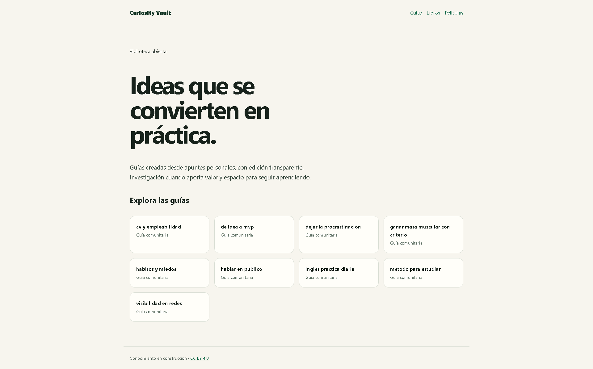

# 🧠 Curiosity Vault



Una plataforma web de aprendizaje y biblioteca abierta a la comunidad (*Digital Garden*) desarrollada con **Astro 7**, diseñada para convertir la curiosidad en guías prácticas, transparentes y aplicables en español.

---

## 📌 1. Problema
El aprendizaje diario suele quedarse disperso entre notas olvidadas, videos guardados en marcadores y pestañas abiertas del navegador. Gran parte del contenido educativo en internet ofrece consejos genéricos o poco aplicables, sin fuentes verificables ni un espacio estructurado donde la comunidad pueda aprender, consultar y colaborar en español.

---

## 🎯 2. Objetivo
Construir una biblioteca abierta a la comunidad, veloz y accesible sobre aprendizaje, empleabilidad, desarrollo de proyectos, hábitos, salud y tecnología. Curiosity Vault transforma apuntes y reflexiones en guías claras con fuentes transparentes y licencias libres (CC BY 4.0) para que cualquier persona pueda aprender y contribuir.

---

## 🛠️ 3. Stack
- **Framework Web**: Astro 7 (Static Site Generation - SSG)
- **Lenguaje**: TypeScript / JavaScript (ESM)
- **Formato de Contenido**: Markdown (.md) con Astro Content Collections
- **Componentes UI**: Componentes Astro nativos (Buscador, Selector de Tema, Progreso de Lectura, Tabla de Contenidos)
- **Licencia**: Creative Commons Attribution 4.0 International (CC BY 4.0)

---

## 📐 4. Arquitectura
El proyecto sigue una estructura limpia y optimizada basada en el motor de contenido de Astro:

```text
curiosity-vault/
├── contenido/                     # Biblioteca de contenidos en Markdown
│   ├── guias/                     # Guías prácticas (estudio, inglés, empleabilidad, etc.)
│   └── colecciones/               # Colecciones de libros, películas y recursos
├── docs/                          # Documentación y recursos multimedia (preview.png)
├── src/
│   ├── content.config.ts          # Configuración del esquema de colecciones en Astro
│   ├── components/                # Componentes UI reutilizables
│   │   ├── Header.astro           # Barra de navegación superior
│   │   ├── Footer.astro           # Pie de página informativo
│   │   ├── Card.astro             # Tarjetas de presentación de guías
│   │   ├── ReadingProgress.astro  # Barra superior de avance de lectura
│   │   ├── SearchModal.astro      # Modal interactivo de búsqueda
│   │   ├── TableOfContents.astro  # Tabla de contenidos dinámica por artículo
│   │   ├── TagFilter.astro        # Filtro de guías por etiquetas
│   │   └── ThemeToggle.astro      # Conmutador de tema Claro / Oscuro
│   ├── layouts/                   # Plantillas base
│   │   └── Base.astro             # Layout global con metadatos SEO y fuentes
│   └── pages/                     # Enrutamiento basado en archivos
│       ├── index.astro            # Landing page / Inicio de la vault
│       ├── [...slug].astro        # Renderizado dinámico de guías y colecciones
│       ├── guias/index.astro      # Catálogo principal de guías
│       └── colecciones/index.astro# Índice de colecciones recomendadas
├── astro.config.mjs               # Configuración del framework Astro
└── package.json                   # Scripts y dependencias del proyecto
```

---

## 📚 Guías publicadas

El sitio contiene actualmente 6 guías prácticas: [De idea a MVP](contenido/guias/de-idea-a-mvp.md), [Energía y descanso](contenido/guias/energia-y-descanso.md), [Finanzas personales](contenido/guias/finanzas-personales.md), [Ganar masa muscular](contenido/guias/ganar-masa-muscular-con-criterio.md), [Hablar en público](contenido/guias/hablar-en-publico.md) y [Método para estudiar](contenido/guias/metodo-para-estudiar.md). Los temas con varias notas relacionadas se consolidaron en 9 colecciones, entre ellas [Empleo](contenido/colecciones/empleo.md), [Desarrollo personal](contenido/colecciones/desarrollo-personal.md), [Negocio y marketing](contenido/colecciones/negocio-y-marketing.md) e [Inglés: práctica y recursos](contenido/colecciones/ingles.md).

## ⚙️ 5. Funcionalidades
- 📚 **Catálogo de Guías Prácticas**: 6 guías individuales y 9 colecciones para reunir apuntes relacionados sobre empleabilidad, negocio, desarrollo personal, idiomas y recursos.
- 🔍 **Modal de Búsqueda (Search Modal)**: Búsqueda interactiva rápida para encontrar guías y recursos de forma inmediata.
- 🌓 **Modo Oscuro / Claro (Theme Toggle)**: Adaptación de tema visual con detección automática del sistema y cambio manual.
- 📖 **Barra de Progreso de Lectura**: Indicador visual que muestra el avance al desplazarse por cada artículo.
- 📑 **Tabla de Contenidos Dinámica**: Generación automática de índices de lectura según los encabezados de cada guía.
- 🏷️ **Filtrado por Etiquetas**: Clasificación de artículos por temas clave para facilitar la exploración.
- 🤝 **Código y Contenido Abierto**: Proyecto abierto a aportes; consulta [`CONTRIBUTING.md`](CONTRIBUTING.md) y [`CODE_OF_CONDUCT.md`](CODE_OF_CONDUCT.md).

---

## 📊 6. Estado Actual
🟢 **Funcional / Activo**: El sitio contiene 6 guías y 9 colecciones, publicadas como páginas estáticas con Astro.

---

## 🖼️ 7. Capturas


---

## 🚀 8. Cómo Ejecutarlo

### Requisitos previos
- **Node.js**: Versión 18.x o 20.x+.
- **Gestor de paquetes**: `npm` (incluido con Node.js).

### Pasos de ejecución
1. **Clonar el repositorio**:
   ```bash
   git clone https://github.com/RomelAnte/curiosity-vault.git
   cd curiosity-vault
   ```

2. **Instalar dependencias**:
   ```bash
   npm install
   ```

3. **Iniciar el servidor de desarrollo**:
   ```bash
   npm run dev
   ```
   Abre tu navegador e ingresa a `http://localhost:4321/`.

4. **Compilar para producción**:
   ```bash
   npm run build
   ```

5. **Previsualizar la compilación de producción**:
   ```bash
   npm run preview
   ```

---

## 🗺️ 9. Roadmap
- [ ] Implementación de buscador con motor a pantalla completa (Pagefind / FlexSearch).
- [x] Tiempo estimado de lectura en cada tarjeta y artículo (200 palabras por minuto).
- [ ] Soporte para guías interactivas en formato MDX.
- [ ] Feed RSS automático para suscripción de lectores.
- [ ] Sistema estático de retroalimentación y reacciones por guía.


